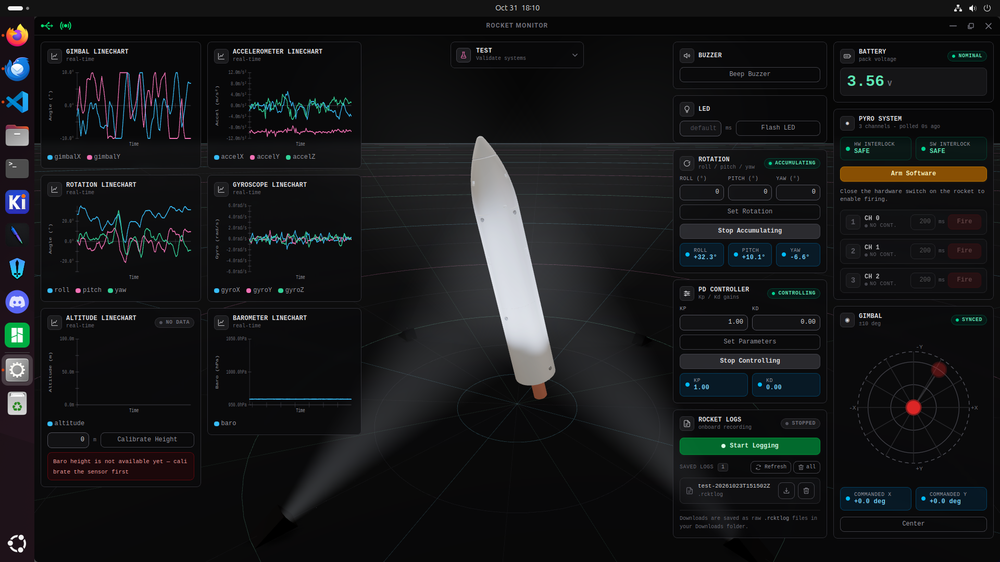

# Rocket Monitor

Rocket Monitor is a desktop app for viewing rocket data, monitoring sensors, controlling onboard systems, and managing flight logs.



## Run locally

Install [Node.js](https://nodejs.org/) and [Rust](https://www.rust-lang.org/tools/install), then run:

```sh
npm install
npm run tauri dev
```